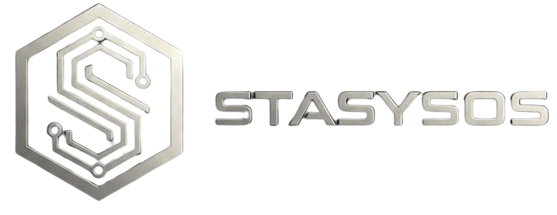
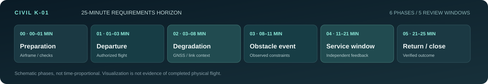
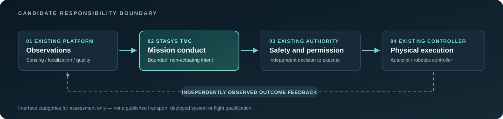

  <strong>PROPRIETARY ONBOARD AUTONOMY · ENGINEERING INTEGRATION BRIEF</strong>

  <a href="README_RU.md">Русская версия</a> ·
  <a href="docs/CIVIL_K01_PRE_READ.md">Civil K-01</a> ·
  <a href="docs/INTEGRATION_INTERFACE.md">Interface</a> ·
  <a href="docs/ENGINEERING_FAQ.md">Engineering FAQ</a> ·
  <a href="docs/MISSION_CONDUCT_EVIDENCE.md">Mission evidence</a> ·
  <a href="docs/TIMING_EVIDENCE.md">Timing</a> ·
  <a href="docs/STATUS_AND_DISCLOSURE.md">Qualification</a>

  

## One integrated autonomy system. Five measurable outcomes.

**The evaluation goal is to determine whether STASYS can replace multiple heavy onboard computing functions while retaining the existing platform's independent vehicle-control and safety authority.**

This is a **single system-level integration proposition**, not a catalogue of individually offered components. Any future one- or two-module physical product is a **design and qualification target**, not a presently proven hardware configuration.

| Buyer outcome | Required externally observed evidence |
|:--|:--|
| Mission continuity with degraded GNSS/communications | Valid-source continuity, safe refusal when state is insufficient, independently confirmed mission outcomes |
| More resource-efficient perception and object continuity | Equal-information sensor/perception comparison, accuracy, latency, memory and power measurements |
| Collision and terrain safety | Scenario-level safe-consequence evidence under the incumbent flight-controller constraints |
| Offline forensic replay | Reproducible admitted input → decision → authorization → independently observed outcome chain, plus explicit divergence detection |
| **Leaderless distributed protective cooperation** | Locally autonomous participants; no central solver, assigned leader, global task allocator or hidden host-selected decisions; controlled failure and held-out tests |

The **cross-cutting buyer criterion** is whole-system reduction in mass, watts, latency, memory, equipment cost and fault exposure — against the integrator's existing solution at comparable functional quality. **No integrated improvement percentage is claimed without a comparative test.**

### Why decentralized cooperation is included

Guardian Veil has a **scoped, frozen positive digital evidence line** for causal local cooperation, relational protective behavior, held-out efficacy and tested fault resilience. A later bounded digital/physical-model result supports functionally distinct local participants cooperating without a central result-selection channel. These results do **not** establish an integrated multi-aircraft hardware system, general environmental protection or operational effectiveness. [Evidence boundaries](docs/RELATED_EVIDENCE_SCOPE.md).

### Existing component evidence supports — but does not certify — the system

STASYS develops proprietary deterministic computing technologies for resource-constrained autonomous systems. The existing evidence base spans bounded mission-conduct experiments, digital perception and adaptive behavior, physical embedded command-gate testing and scoped digital leaderless protective cooperation. Their joint integration and complete cost/weight/power advantage are **not yet established**.

This is a **technical pre-read for system integrators**, not an offer of source code or a claim of a certified, flight-ready product. External interfaces and observable acceptance criteria are available for discussion; the internal computation remains proprietary.

<table>
<tr>
<td width="33%" valign="top">
<strong>01 · Resource consolidation</strong>
Compare complete platform mass, watts, RAM, latency and equipment count at equivalent functional quality.

</td>
<td width="33%" valign="top">
<strong>02 · Independent authority</strong>
Preserve the incumbent flight controller and safety boundary while evaluating a smaller computing configuration.

</td>
<td width="33%" valign="top">
<strong>03 · Reproducible comparison</strong>
Demonstrate observable behavior and independently measured outcomes without publishing implementation details.

</td>
</tr>
</table>

## A defined engineering case — Civil K-01

**Civil K-01 is one mission-continuity evaluation scenario, not an all-function benchmark or an independently validated distributed protective deployment.**

**The evaluation scenario already exists.** Civil K-01 describes a 25-minute civilian mission with six phases and five timed evaluation windows, supported by a requirements visualization and separate controlled laboratory research.

The viewer communicates *the intended operating sequence*. The separate laboratory work examines bounded computational behavior. Neither alone establishes an end-to-end completed physical flight.

**[Explore the Civil K-01 engineering case →](docs/CIVIL_K01_PRE_READ.md)**

## Architecture at the integration boundary

The diagram illustrates **the mission-conduct seam only**, not the complete Morphic Vision / Morphic AI / Guardian Veil / DRC composition. It is a **candidate responsibility model**, not an implemented data protocol. The interface is intended to preserve these distinctions:

| System responsibility | Integration position |
|:--|:--|
| Observations, localization and data validation | Existing platform |
| Mission objective and bounded continuation proposals | **STASYS TMC** — proprietary mission-conduct component |
| Execution permission and failsafe decisions | Existing independent authority |
| Flight / robot motion | Existing controller and executor |
| Evidence of action outcome | Independently verified platform feedback |
| Optional command-path assurance | Separate **DRC/SRC** assessment where required |

**TMC is not an autopilot.** Its output is a proposal rather than authority to actuate. A partner's existing safety boundary and control logic are not bypassed.

**[Read the proposed interface contract →](docs/INTEGRATION_INTERFACE.md)**

## Technical review — four documents

<table>
<tr>
<td width="50%" valign="top">
<strong>01 / Evaluation scenario</strong>

Define the known civil mission, relevant operating interruptions and what the visual laboratory does and does not demonstrate.

<a href="docs/CIVIL_K01_PRE_READ.md">Civil K-01 briefing →</a>
</td>
<td width="50%" valign="top">
<strong>02 / Integration architecture</strong>

Candidate inputs and outputs, authority boundary, feedback responsibilities and non-actuating evaluation gates.

<a href="docs/INTEGRATION_INTERFACE.md">Integration interface →</a>
</td>
</tr>
<tr>
<td valign="top">
<strong>03 / Engineering answers</strong>

Processor placement, protocol assumptions, localization degradation, perception and the information needed from the platform team.

<a href="docs/ENGINEERING_FAQ.md">Engineering FAQ →</a>
</td>
<td valign="top">
<strong>04 / Qualification and rights</strong>

Readiness scope, independent testing, restricted disclosures and the boundary between evaluation and licensing.

<a href="docs/STATUS_AND_DISCLOSURE.md">Status &amp; disclosure →</a>
</td>
</tr>
</table>

## Public evidence

- [Mission conduct evidence](docs/MISSION_CONDUCT_EVIDENCE.md): what was observed in one continuous digital session, how the legacy offline corpus differs, and what remains unmeasured.
- [Timing evidence](docs/TIMING_EVIDENCE.md): what the STM32 bench measured and why that result is not an end-to-end latency claim.
- [Integrated capability boundaries](docs/RELATED_EVIDENCE_SCOPE.md): scoped Guardian Veil digital evidence, Morphic Vision, Morphic AI, DRC embedded hardware, and forensic replay; no automatic cross-component promotion.

## The next technical decision

The practical objective is to agree on a **whole-system evaluation specification** for the integrator's five stated outcomes and a comparable existing-stack baseline. Civil K-01 is one bounded scenario, and the digital Guardian Veil evidence is another separate evaluation line. First validate a non-actuating, independently observable interface and resource budget; do not silently treat these different research results as a verified single deployment.

Selected software and embedded-control mechanisms have controlled laboratory evidence. **Platform-specific compatibility and complete mission-level field qualification remain separate acceptance requirements.** This public package provides no proprietary implementation, unrestricted test image, patent license or commercial terms.

<strong>STASYS · EXTERNAL INTERFACES, CONTROLLED EVIDENCE, PROPRIETARY COMPUTATION</strong>

Public technical pre-read · 23 November 2026 · <a href="LEGAL.md">Rights and restrictions</a>
