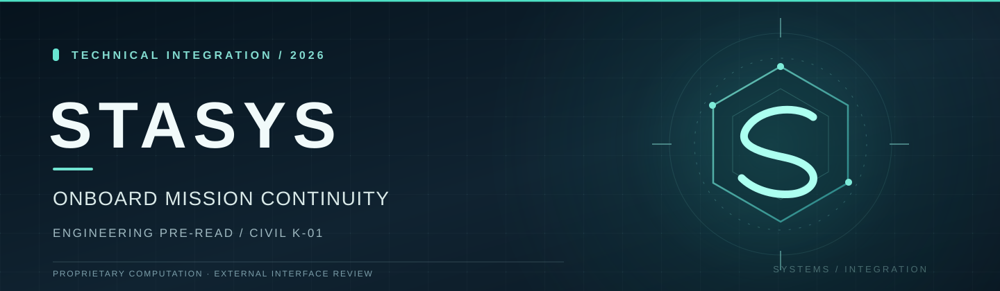

<strong>STASYS · БОРТОВАЯ НЕПРЕРЫВНОСТЬ МИССИИ · ТЕХНИЧЕСКАЯ ИНТЕГРАЦИЯ</strong>

<a href="README.md">English</a> · <a href="docs/CIVIL_K01_PRE_READ.md">Civil K-01</a> · <a href="docs/INTEGRATION_INTERFACE.md">Интерфейсы</a> · <a href="docs/ENGINEERING_FAQ.md">FAQ</a>

## Автономное ведение миссии в существующей платформе

STASYS разрабатывает проприетарные детерминированные вычислительные технологии для бортовых систем с ограниченными ресурсами. **TMC** рассматривается как отдельный вычислительный модуль, который сохраняет заданную цель и формирует ограниченные миссионные намерения на основе допущенного контекста и фактических последствий.

Штатные датчики, локализация, стабилизация, полётный контроллер и независимые механизмы безопасности **сохраняют свои полномочия**. TMC не управляет исполнительными механизмами напрямую.

## Уже определённый сценарий — Civil K-01

Исследуем не произвольную задачу, а согласованный по постановке **25-минутный гражданский сценарий** с шестью фазами и пятью контрольными окнами.

Для сценария существуют визуализация требований и отдельная лабораторная работа. Их нельзя трактовать как подтверждение полного физического полёта.

[**Технический обзор Civil K-01 (EN)**](docs/CIVIL_K01_PRE_READ.md)

## Предлагаемая граница интеграции

| Функция | Ответственный компонент |
|:--|:--|
| Сенсоры, качество наблюдений, навигация | Существующая платформа |
| Формирование следующего миссионного намерения | STASYS TMC |
| Допуск и ограничения безопасности | Независимый контур платформы |
| Физическое исполнение | Штатный контроллер |
| Подтверждение результата | Независимая обратная связь |

## Документы для технической команды

- [Civil K-01 — исходный сценарий и границы демонстрации](docs/CIVIL_K01_PRE_READ.md)
- [Integration Interface — входы, выходы и полномочия](docs/INTEGRATION_INTERFACE.md)
- [Engineering FAQ — ответы программистам и требования к платформе](docs/ENGINEERING_FAQ.md)
- [Status & Disclosure — статус испытаний и границы раскрытия](docs/STATUS_AND_DISCLOSURE.md)
- [Права и ограничения](LEGAL.md)

**Цель технической встречи:** определить интерфейс получения достоверных наблюдений, формирования миссионного предложения и проверки исполненного результата на существующей платформе. Затем согласовать минимальное невмешивающееся испытание.

Отдельные механизмы имеют лабораторные результаты. Готовность полного комплекса для конкретного борта и полевой эксплуатации требует самостоятельной проверки.

<strong>STASYS · EXTERNAL INTERFACES · PROPRIETARY COMPUTATION</strong>

